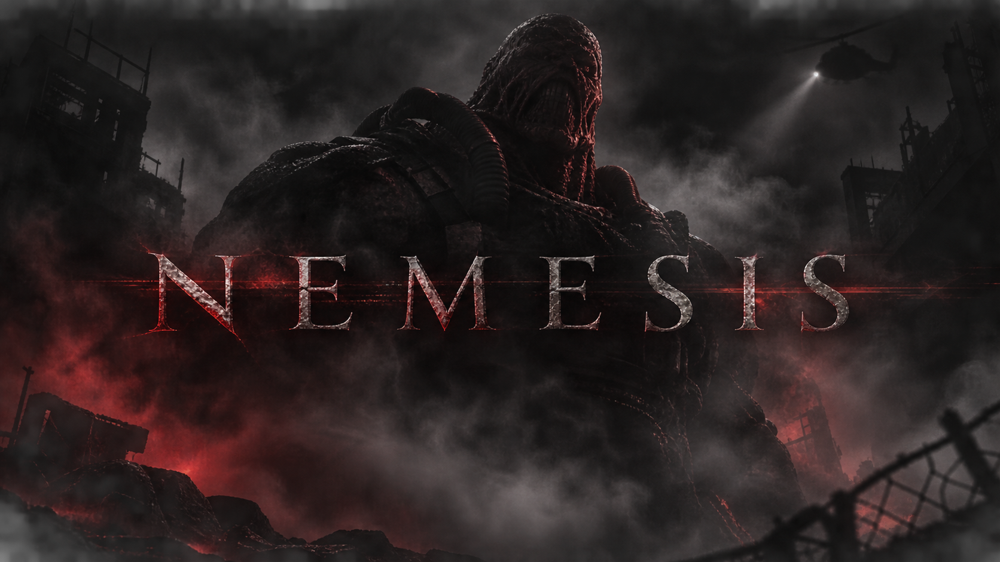

# NEMESIS

**An extensible AI ecosystem designed to push beyond existing boundaries.**

NEMESIS is a project focused on overcoming one of the fundamental limitations of AI systems: the Context Window.

Its goal is not simply to provide another AI interface, but to build a comprehensive AI ecosystem that users can extend, customize, and automate according to their needs.

NEMESIS aims to empower users to give AI new capabilities, integrate external tools, and build their own workflows.

---

---

## 🧠 Core Vision

In traditional AI systems, the Context Window is a significant limitation when handling long-term interactions and large amounts of information.

NEMESIS aims to overcome this limitation by continuously expanding the available context capacity, with the ultimate vision of achieving an effectively unlimited Context Window.

To pursue this vision, NEMESIS embraces extensibility and puts user control at the center of its design philosophy.

## ⚡ Key Features

### 🧩 Skill System
Users will be able to add their own Skills to NEMESIS, allowing its capabilities to grow and adapt to different needs and use cases.

### 🔄 Automation
NEMESIS aims to support the automation of repetitive tasks and the creation of workflows that combine multiple operations.

### 🔌 MCP Integration
Through MCP (Model Context Protocol) Server support, NEMESIS aims to enable integrations with external tools and services.

### 🛡️ Security
NEMESIS will include Cloudflare's [security-audit-skill](https://github.com/cloudflare/security-audit-skill) as one of its default Skills.

This makes security auditing one of the foundational capabilities of the ecosystem.

## 🎯 Project Goals

The long-term goal of NEMESIS is to transform AI from a tool with a fixed set of capabilities into an extensible platform that users can customize and integrate with different systems.

Users should not be limited to predefined capabilities. They should be able to create, add, and expand functionality according to their own requirements.

## 💭 Our Philosophy

> The future will be built with open, transparent, and understandable systems — not invisible black boxes.

This is the fundamental philosophy behind NEMESIS.

Technology should be valued not only for what it can do, but also for how clearly its inner workings can be understood.

---

**NEMESIS — Beyond the Context.**
